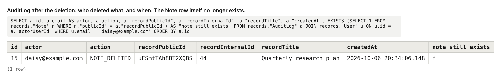
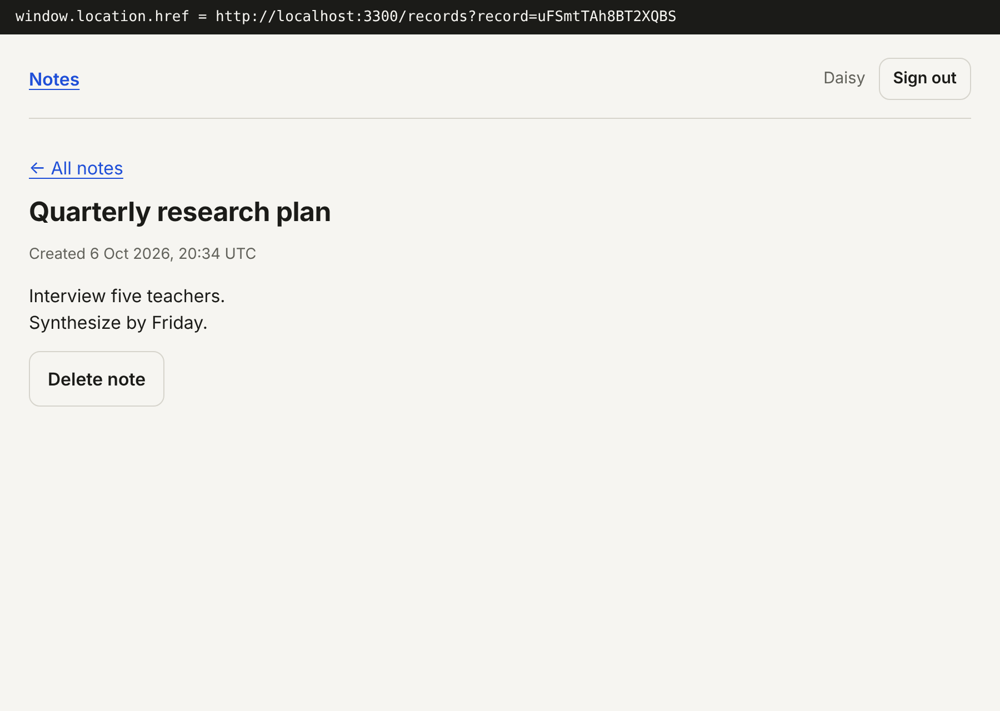
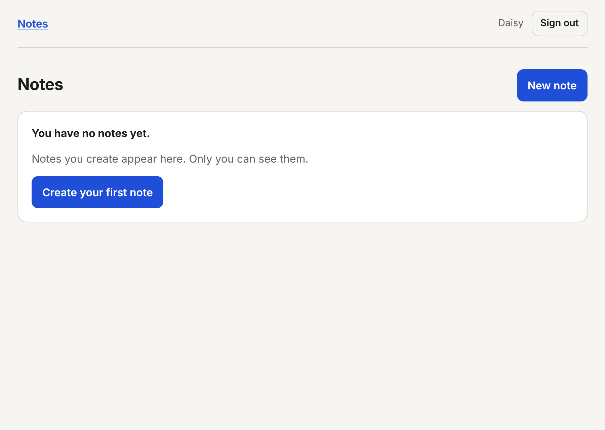
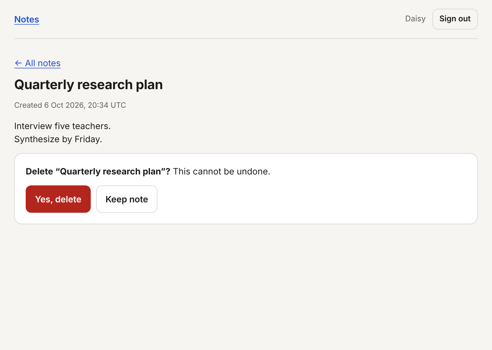

# Records and Access Slice: Documentation

Assessment 4 of the Four Build Assessments. Stack: Next.js (App Router), TypeScript, Prisma, PostgreSQL.

Supporting files: [`PRD.md`](PRD.md) (the specification), [`RULES.md`](RULES.md) (checkable constraints), [`AGENTS.md`](AGENTS.md) and [`skills/`](skills) (how coding agents must work here), [`docs/DISCOVERY.md`](docs/DISCOVERY.md), and [`evidence/`](evidence).

---

## Section 1: What This Is

This is a flow in which a signed-in user creates notes, sees a list of their own notes, opens one, and deletes one, built so that no user can ever reach another user's notes. Every database query on notes carries the signed-in user's id inside the query itself. Clients only ever see a random public identifier, never the database's own. Every deletion writes an audit record in the same atomic statement that removes the row. The three views (list, create, detail) are one page whose view is chosen by the URL, so moving between them is instant and every view can still be bookmarked or shared. The slice was then attacked as a second user over HTTP, and its database queries were counted before and after optimisation.

It deliberately has no landing page, editing, search, tags, sharing or collaboration, and no dashboard widgets: the brief says create, list, view, delete, and that is all. The notes themselves are as plain as possible (a title and a body) because the domain is not what is being assessed. To have a signed-in user it reuses the authentication slice from Assessment 1 (`src/lib/auth/`, `src/app/(auth)/`, `src/app/api/auth/`), with one change made for this slice and described in Section 5: the session lookup became a single statement.

---

## Section 2: How To Run It

**What to install:** Node.js 20.12 or newer (built and tested on 22) and a PostgreSQL database, local or hosted.

1. Clone and install. `npm install` also generates the Prisma client.
   ```bash
   git clone https://github.com/daisydev11/records-access-slice.git
   cd records-access-slice
   npm install
   ```
2. Create your environment file and fill it in by hand.
   ```bash
   cp .env.example .env
   ```
   | Variable | Required | Where it comes from |
   |---|---|---|
   | `DATABASE_URL` | Yes | Your Postgres connection string. Keep `?schema=records` on the end. |
   | `APP_URL` | Yes | Where the app runs. Locally `http://localhost:3000`. |
   | `RESEND_API_KEY`, `EMAIL_FROM` | No | For real emails. If empty, verification codes print to the server terminal. |
3. Create the tables.
   ```bash
   npx prisma migrate deploy
   ```
4. Start it.
   ```bash
   npm run dev
   ```
5. Open **http://localhost:3000**, create an account (the verification code appears in the terminal on a line starting `[email:dev]`), and you land on **Notes**, empty.

**Reproducing the evidence**

| Command | What it does |
|---|---|
| `npm test` | 31 tests, including two-user ownership tests against the database and a test that fails if any file outside the repository queries notes. |
| `npm run audit` | With the server running: creates two users, attacks every record route over HTTP, and writes `evidence/access-control-audit.md`. Pass a base URL to target another address. |
| `npm run build && npm run measure` | Starts the built server with statement logging and prints every SQL statement each main action sends. |

---

## Section 3: The Flow, Step By Step

Everything that touches notes goes through one file, `src/lib/records/repo.ts`, which is only usable as `notesFor(userId)`.

**1. Arriving.** The user opens `/records`. `src/middleware.ts` redirects to `/signin` if there is no session cookie. The layout (`src/app/(app)/layout.tsx`) calls `getSessionUser()` in `src/lib/auth/session.ts`, which reads the cookie, hashes it, and looks up the session and its user in one statement. The page (`src/app/(app)/records/page.tsx`) calls the same function; within one request the second call reuses the first answer.

**2. The list.** With no query string, the page calls `notesFor(user.id).list()`, which runs `SELECT … WHERE "userId" = $1 ORDER BY "createdAt" DESC`. The page renders the titles as links to `/records?record=<publicId>`. With no notes it renders the empty state, which says so and offers "Create your first note". There is no sample data.

**3. The create view.** "New note" is a link to `/records?view=create`. Next.js handles it as a client-side navigation: no full page load, the URL changes, and the server sends only the new view. The page sees `view=create` and returns the form (`src/components/records/CreateNoteForm.tsx`) without reading the list.

**4. Creating.** The user types a title and a note and presses Save. The form validates with `createNoteSchema` from `src/lib/validation/records.ts` and sends `POST /api/records` with `{ title, body }`. The handler (`src/app/api/records/route.ts`) refuses cross-site origins, requires a session, validates the body against the same schema, and calls `notesFor(user.id).create(...)`. The owner is taken from the session; a `userId` in the request body is not read. The repository generates a public identifier (`src/lib/records/public-id.ts`) and inserts the row. The server answers `201` with the note's public fields, and the form navigates to `/records?record=<publicId>`.

**5. The detail view.** The page sees `record=<publicId>` and calls `notesFor(user.id).get(publicId)`, which runs `SELECT … WHERE "publicId" = $1 AND "userId" = $2`. If a row comes back it renders the note. If not, it renders "Note not found", whether the identifier belongs to someone else, never existed, or is malformed.

**6. Deleting.** "Delete note" (`src/components/records/DeleteNote.tsx`) first shows a confirmation naming the note. "Yes, delete" sends `DELETE /api/records/<publicId>`. The handler (`src/app/api/records/[publicId]/route.ts`) refuses cross-site origins, requires a session, and calls `notesFor(user.id).delete(publicId)`. That runs one statement: a `DELETE … WHERE "publicId" = $1 AND "userId" = $2 RETURNING …` whose result feeds an `INSERT INTO "AuditLog"`. One row logged means one note deleted, and the server answers `200`; zero means there was no such note for this user, and it answers `404`. The browser returns to `/records` and the list no longer contains the note.

**7. Back, forward, bookmarks.** Because each view is a URL, the back button moves create → list, forward returns, and pasting `/records?record=<publicId>` into a new tab opens that note directly, after the same session and ownership checks.

---

## Section 4: The Data Model

Defined in `prisma/schema.prisma`; SQL in `prisma/migrations/20261006210000_records/migration.sql`. `User`, `Session` and the other auth tables are reused from Assessment 1.

```prisma
model Note {
  id        Int      @id @default(autoincrement())
  publicId  String   @unique
  userId    String   // FK -> User, ON DELETE CASCADE
  title     String
  body      String
  createdAt DateTime @default(now())
  @@index([userId, createdAt])
}

model AuditLog {
  id               Int         @id @default(autoincrement())
  actorUserId      String      // FK -> User, ON DELETE RESTRICT
  action           AuditAction // NOTE_DELETED
  recordPublicId   String
  recordInternalId Int
  recordTitle      String
  createdAt        DateTime    @default(now())
  @@index([actorUserId, createdAt])
}
```

**Note** holds one row per note.
- `id` is the internal primary key: a small sequential integer, efficient for storage and joins. It is never sent to a client.
- `publicId` is what clients see: 16 random URL-safe characters (96 bits). Unique, because it is how a note is addressed.
- `userId` is the owner, `NOT NULL` with a foreign key. A note cannot exist without an owner.
- `title` and `body` are `NOT NULL`; an empty body is the empty string, so there is one representation of "no text".
- There is no `updatedAt`: notes cannot be edited, so the column would never change.

**AuditLog** holds one row per deletion.
- `actorUserId` is who did it. Its foreign key uses `ON DELETE RESTRICT`: a user with audit history cannot be silently removed along with it.
- `recordPublicId`, `recordInternalId` and `recordTitle` are **copies** of the deleted note's identity, not a reference to it. There is deliberately no foreign key to `Note`: the whole purpose of the row is to say what was deleted after that row no longer exists.
- `action` is an enum so that only known actions can be recorded.

**Indexes, and the query each one serves**

| Index | Serves | Why it matters |
|---|---|---|
| `Note(userId, createdAt)` | The list: `WHERE userId = ? ORDER BY createdAt DESC` | Without it, listing one user's notes scans every user's notes. With 40,000 notes across 200 users, `EXPLAIN` shows a `Bitmap Index Scan on "Note_userId_createdAt_idx"`. |
| `Note(publicId)` unique | Detail and delete: `WHERE publicId = ? AND userId = ?` | One index probe finds the row (`Index Scan using "Note_publicId_key"`), then `userId` is checked on it. |
| `AuditLog(actorUserId, createdAt)` | Reading one user's audit history in order | The natural question asked of an audit log. |

No other indexes exist. `title` and `body` are never filtered or sorted on.

### Which constraints in this schema make an invalid state impossible?

| Constraint | The invalid state it rules out |
|---|---|
| `NOT NULL` + foreign key on `Note.userId` | A note with no owner, which no scoped query would ever return and no one could delete. |
| `UNIQUE (publicId)` | Two notes answering to one address. |
| `CHECK (publicId ~ '^[A-Za-z0-9_-]{16}$')` | A note stored with a malformed or guessable identifier, such as a copy of its own numeric id. |
| `CHECK` on `title` length after trimming (1 to 120) | A blank or whitespace-only title, which would render as an unclickable empty link in the list. |
| `CHECK (char_length(body) <= 5000)` | An oversized note written by some path that skipped validation. |
| `ON DELETE RESTRICT` on `AuditLog.actorUserId` | Audit rows orphaned or erased by deleting the person they describe. |
| No foreign key from `AuditLog` to `Note` (a deliberate absence) | An audit row that cannot be written, or is cascaded away, because the record it describes is being deleted. |
| Enum type on `action` | A misspelt or invented action in the audit trail. |

---

## Section 5: The Concepts

### Authentication Versus Authorisation

**What it is.** Authentication answers "who is making this request?". Authorisation answers "is this person allowed to do this, to this thing?". They are separate questions, and passing the first says nothing about the second.

**Why it is needed.** An application that only authenticates lets any signed-in user do anything. Being signed in proves you are *a* user; it does not make every note yours. Without authorisation, the second person to sign up can read the first person's notes by asking for them.

**How I implemented it.** Authentication is `getSessionUser()` (`src/lib/auth/session.ts`), reached through `requireUser()` in route handlers. Its only output is a user id. Authorisation is that id inside every query, in `src/lib/records/repo.ts`. The two meet on two lines of a handler:

```ts
const auth = await requireUser();                 // authentication: who?
if (auth.response) return auth.response;          // nobody -> 401
const note = await notesFor(auth.user.id).get((await params).publicId);   // authorisation: theirs?
return note ? NextResponse.json({ note }) : notFound();
```

**What I chose against, and why.** A roles-and-permissions system (admin, member, a permissions table) is the general tool for authorisation. I chose against it because this slice has exactly one rule, "a note belongs to its creator", and that rule is a column. A permissions layer would add a second place where access is decided and a way for the two to disagree.

### Scoping The Query Versus Checking After The Fetch

**What it is.** There are two ways to stop a user reading someone else's record. Checking after the fetch: load the record by its identifier, then compare its owner with the current user. Scoping the query: put the owner in the `WHERE` clause, so a record that is not the user's is never loaded at all.

**Why it is needed.** The after-fetch check works on the day it is written and depends on being written again, correctly, in every route added afterwards. Forgetting it produces no error and no failing page; the route simply works, for everyone, on everyone's data. With scoping there is no second step to forget. The leak is structurally impossible because the other user's row never leaves the database.

**How I implemented it.** Notes are only reachable through `notesFor(userId)`, and every statement in that file names the user:

```ts
get(publicId: string): Promise<PublicNote | null> {
  if (!PUBLIC_ID_PATTERN.test(publicId)) return Promise.resolve(null);
  return db.note.findFirst({ where: { publicId, userId }, select: PUBLIC_FIELDS });
},
```

**If the user condition is removed** from that `where`, any signed-in user can read any note whose identifier they have. I tested this instead of asserting it: I removed `userId` from the lookup and from the delete statement and ran the audit. 8 of 31 rows failed. User B read user A's note through the API and through the page, and deleted it. The other five failures followed from A's note no longer existing.

Two tests keep it this way. `tests/security/scoping.test.ts` reads the source and fails if any file other than the repository references the Note table, if any statement in the repository lacks `userId`, or if any code compares `.userId` after a fetch. It failed during the experiment above, before the audit was even run.

**What I chose against, and why.** The after-fetch check (`if (note.userId !== user.id) return 403`) is the common pattern and is what the brief warns about. I also chose against a helper such as `assertOwner(note, user)` called in each handler: it is tidier, and it is still a call someone has to remember. Postgres row-level security would enforce the same rule inside the database for every query from any code, and is the stronger tool; I chose against it here because it needs the user id set on each database connection, which works against connection pooling and is hard to see when reading the code.

### Insecure Direct Object References

**What it is.** An insecure direct object reference (IDOR) is when an application uses an identifier supplied by the user to fetch an object directly, without checking that this user may have it. The attack is editing the identifier.

**Why it is needed.** It needs no tools and no skill: a user looks at `/records?record=abc` in their address bar and changes it. If that returns someone else's record, every record in the system is readable by walking through identifiers. It is among the most common serious flaws in web applications because nothing looks broken until someone tries.

**How I implemented it.** A changed identifier meets these layers, in order:
1. **Middleware** (`src/middleware.ts`): no session cookie, redirect to sign in.
2. **Authentication**: the cookie must match a live session row; otherwise `401`.
3. **Format**: the identifier must be 16 URL-safe characters, or the repository returns nothing without querying.
4. **The scoped query**: `WHERE "publicId" = $1 AND "userId" = $2`. A guessed identifier that happens to be real still matches zero rows unless it is this user's.
5. **The response**: zero rows is `404` with no detail, the same as for an identifier that never existed.

`npm run audit` performs this attack as user B against user A's notes: the real identifier, one edited by a character, a random guess, the raw database id, a SQL injection string and an oversized string, on both the read and the delete routes. All return `404` and A's data is unchanged ([`evidence/access-control-audit.md`](evidence/access-control-audit.md)).

**What I chose against, and why.** Making identifiers unguessable and stopping there is the trap the brief names: obscurity is not access control. Identifiers leak through browser history, screenshots, shared links and logs, so the system has to be safe when the attacker holds a valid one. That is why the first row of the detail attacks uses A's real identifier.

### Why Raw Database Identifiers Are Not Exposed

**What it is.** A raw database identifier is the primary key the database uses internally, here a counting integer. Not exposing it means clients are given a different, random identifier and never see the real one.

**Why it is needed.** A sequential id tells an outsider things they should not know: note 1,042 means about a thousand notes exist, two ids a day apart reveal how fast the product is growing, and the neighbours of any id are valid ids to try. It also ties the public address of a record to a storage detail I may want to change.

**How I implemented it.** `Note.id` is an autoincrement integer used only inside the database. `Note.publicId` is 12 random bytes as 16 base64url characters (`src/lib/records/public-id.ts`). The repository returns rows through one field list that does not contain `id`:

```ts
const PUBLIC_FIELDS = { publicId: true, title: true, body: true, createdAt: true } as const;
```

A test asserts that returned objects have exactly those keys, and the audit confirms the internal id is not accepted as an identifier (`404`) and does not appear in API responses or page HTML. The second screenshot below shows a note's URL.

**What I chose against, and why.** Using a UUID or CUID as the primary key itself gives one unguessable column and is simpler. I chose two columns because the brief asks that the exposed identifier not be the database identifier, and because an integer key keeps indexes and joins small. I also chose against encoding the integer reversibly (hashids): it looks random and can be decoded back to the sequence by anyone who learns the scheme.

### Audit Logging, And Why Deletions Are Recorded

**What it is.** An audit log is a table of facts about actions: who did what, to what, and when. Recording deletions means that when a row disappears, a row describing its disappearance is written.

**Why it is needed.** A delete destroys its own evidence. Afterwards, "my note is gone, I did not delete it" cannot be answered from the data: there is nothing to look at. Without a record I cannot tell a user action from a bug, an attack or a restore gone wrong, and I cannot tell the user anything true.

**How I implemented it.** The delete and its audit row are one SQL statement, in `delete()` in `src/lib/records/repo.ts`:

```sql
WITH deleted AS (
  DELETE FROM "Note" WHERE "publicId" = $1 AND "userId" = $2
  RETURNING "id", "publicId", "title"
)
INSERT INTO "AuditLog" ("actorUserId", "action", "recordPublicId", "recordInternalId", "recordTitle", "createdAt")
SELECT $2, 'NOTE_DELETED', "publicId", "id", "title", $3 FROM deleted
```

The audit row is built from what the delete returned, so it cannot describe a deletion that did not happen, and it is part of the same statement, so a deletion cannot happen without it. A test forces the audit insert to fail and asserts the note is still there. Deleting someone else's note, or the same note twice, writes nothing. The row copies the note's identifiers and title because, a moment later, there is no note left to join to.

**What I chose against, and why.** Logging after the delete, as a second call, is the trap the brief names: the row is gone, and if the log write fails the deletion has happened with no record. A soft delete (a `deletedAt` column) keeps everything and is a reasonable design, but then every query must also remember `deletedAt IS NULL`, a second condition that can be forgotten in the same way as ownership, and "deleted" data is not actually deleted. A database trigger would also be atomic, but the trigger cannot know who the signed-in user is without that being passed into the database session.

### Page Architecture: Conditional Rendering With URL State

**What it is.** Conditional rendering means one page shows different views (list, create form, one note) depending on some state. URL state means that state lives in the address, here the query string, and not only in the page's memory.

**Why it is needed.** Each half fails alone. Separate pages for each view, with full reloads, are slow and lose scroll and context on every click. A single page that switches views in memory is fast, but the address never changes: a note cannot be bookmarked or sent to someone, refresh returns to the list, and the back button leaves the application. Together, navigation is fast and every view is addressable.

**How I implemented it.** One page, `src/app/(app)/records/page.tsx`, reads the query string and returns one of three views:

```tsx
const { view, record } = await searchParams;
if (view === "create") return <CreateView />;       // /records?view=create
if (record) return <DetailView id={record} />;      // /records?record=<publicId>
return <ListView />;                                 // /records
```

Views are changed with Next.js `<Link>` and `router.push`, which update the URL and fetch only the new view, without reloading the document. In a browser test, a marker set on `window` at first load was still present after moving list → create → detail → back → back → forward → forward and after deleting, and the browser recorded one document load for the whole sequence. Opening a note's URL in a new tab rendered that note directly.

**What I chose against, and why.** Client-only state (`useState("list" | "create" | "detail")`) is the version that forgets the URL. Separate routes (`/records/new`, `/records/[id]`) are also addressable and equally valid in Next.js; I used the query string because the brief describes one page with conditional views, and it keeps all three in one file where the branching is visible. I chose against a modal over the list for the detail view, which makes the URL and the back button harder to get right for no gain here.

### Status Codes: 401 Against 403

**What it is.** `401 Unauthorized` means "I do not know who you are": there is no valid session. `403 Forbidden` means "I know who you are, and you may not do this". `404 Not Found` means "there is nothing here for you".

**Why it is needed.** Clients act on the code. `401` tells the interface to send the user to sign in; signing in will fix it. `403` tells it not to bother: signing in again changes nothing. Returning the wrong one either loops a signed-in user through the sign-in page or tells an anonymous caller that a resource exists.

**How I implemented it.** The policy, written in `RULES.md` and applied in both record route files:

| Situation | Code | Reason |
|---|---|---|
| No session, expired session, forged cookie | `401` | Identity unknown. |
| A note that is not the caller's: someone else's, non-existent, or malformed id | `404` | See below. |
| A request carrying another site's `Origin` header | `403` | The server refuses this request for what it is, whoever sent it. |
| Input that fails validation | `422` | |
| `PUT` or `PATCH` on a note | `405` | No such operation exists. |

**Why a note that is not yours is `404` and not `403`.** Two reasons. First, `403` would confirm that the identifier is real, which tells an attacker that guessing works and which guesses hit. Second, and decisively: to answer `403` the server would have to know the note exists and belongs to someone else, and the only way to know that is an unscoped query, `WHERE publicId = ?` without the user. That is exactly the query this design forbids. The scoped query returns zero rows in both cases, the server honestly cannot tell them apart, and `404` is the truthful answer.

So `403` is reserved for its real meaning. In this slice that is the cross-site check in `src/lib/http.ts`, and in the reused sign-in flow, a correct password on an unverified email.

**What I chose against, and why.** `403` for another user's record is what many APIs do and is arguably the more literal reading of the code. I chose against it for the two reasons above. I also chose against returning `404` for unauthenticated requests to hide the API's existence: the interface needs `401` to know it should send the user to sign in.

### Database Indexing

**What it is.** An index is a sorted structure the database keeps alongside a table so it can find rows by a column's value without reading the whole table, the way a book's index finds a page.

**Why it is needed.** Scoping every query to a user means every query filters on `userId`. Without an index on it, listing my ten notes reads every user's notes and discards almost all of them, and the cost of my page grows with everyone else's data. The list is also sorted by date; without an index that includes the date, the rows are sorted from scratch on each request.

**How I implemented it.** One composite index for the one list query, declared next to the model:

```prisma
// Serves the list: WHERE userId = ? ORDER BY createdAt DESC.
@@index([userId, createdAt])
```

plus the unique index on `publicId`, which serves detail and delete. I checked both with `EXPLAIN` against 40,000 notes spread over 200 users (inserted and rolled back in a transaction): the list used `Bitmap Index Scan on "Note_userId_createdAt_idx"`, and the lookup used `Index Scan using "Note_publicId_key"` with `userId` as a filter on the one row found.

**What I chose against, and why.** A single-column index on `userId` would serve the filter; the composite one costs little more and keeps the rows in date order for the same query. I chose against a composite `(publicId, userId)` index: `publicId` is already unique, so the lookup finds at most one row and a second column would add size without removing work. I added no index on `title` or `body`, because nothing searches them; an unused index slows every insert for no benefit.

### Query Count As A Cost

**What it is.** Every database query is a round trip: the application sends a statement, waits, and reads the answer. Query count is how many of those one user action causes.

**Why it is needed.** Each round trip takes time whatever the query does, usually a millisecond or more on a real network, and holds a database connection while it waits. An action that sends seven statements where two would do is slower for the user and uses connections that other requests are waiting for. The count is also invisible: nothing in the code said that one line was two queries, or that two components were each asking the same question.

**How I implemented it.** I measured at the Postgres driver (`QUERY_LOG=1` in `src/lib/db.ts`, run by `npm run measure`), so `BEGIN`, `COMMIT` and anything the ORM adds are counted. First working version against final:

| Action | Before | After | Reduction |
|---|---|---|---|
| List | 5 | 2 | 60% |
| Create | 3 | 2 | 33% |
| Delete | 7 | 2 | 71% |
| **All three** | **15** | **6** | **60%** |

After: one statement to authenticate, one to do the work, for every action. The full statement-by-statement classification is in [`evidence/query-count.md`](evidence/query-count.md). The four changes, each measured in its own commit:

1. **Session and user in one JOIN.** Prisma's nested `select` on the session sent two statements. Saved 1 on every request, 2 on pages.
2. **Session resolved once per request.** The layout and the page each looked it up. React's `cache()` makes the second call reuse the first.
3. **Each view loads only what it shows.** The detail view was also reading the list.
4. **Delete and audit in one statement.** Replaced a lookup, `BEGIN`, an insert, a delete and `COMMIT`.

**The single change that did the most** was the first: 6 statements across the four measured actions, because authentication is paid on every request, so a cost there is multiplied by everything else. For one action alone, the single-statement delete saved the most, taking Delete from 6 to 2.

**What I chose against, and why.** Caching the session across requests (in memory or Redis) would remove the authentication statement entirely, taking every action to 1. I chose against it because a cached session keeps working after sign out or a password reset until the cache expires, and Assessment 1's sessions are revocable on purpose. I did not remove a `userId` condition anywhere to save a statement; a change like that is a security bug, not an optimisation.

### The Single Change That Would Have Prevented The Most Audit Failures

The final audit has no failing rows, so this is answered from the experiment in which I took the protection away. Making the repository the only way to reach notes, with the user id required to obtain it (`notesFor(userId)`), is that change. With the ownership condition removed from two statements, 8 of 31 audit rows failed, covering every cross-user read and delete. Every one of them is prevented by the same thing: the condition being part of the only query that can be written. A per-route check would have had to be remembered in four handlers and one page; the scoped repository has to be right in one file, and a test fails if a second file appears.

### Evidence

**1. The access-control audit table.** 31 attempts, two users, every route, all passing. Generated by `npm run audit`; the full table with what was attempted and what happened on each row is in [`evidence/access-control-audit.md`](evidence/access-control-audit.md). An extract:

| User | Method | Path | Attempt | Actual | Status | Result |
|---|---|---|---|---|---|---|
| B | GET | `/api/records/<A's publicId>` | Direct request for A's note using its real public identifier | NOT_FOUND, A's content absent | 404 | **PASS** |
| B | GET | `/api/records/<A's internal database id>` | Raw database identifier in place of the public one | NOT_FOUND, A's content absent | 404 | **PASS** |
| B | POST | `/api/records` | Mass assignment: body claims userId = A, publicId = A's note | created for B, new identifier issued, A still has 2 notes | 201 | **PASS** |
| B | DELETE | `/api/records/<A's publicId>` | Cross-user deletion using the real public identifier | NOT_FOUND; A's note still exists; audit rows: 0 | 404 | **PASS** |
| A | DELETE | `/api/records/<A's publicId>` | Cross-site request forgery: A's own cookie, another site's Origin | CROSS_SITE; A's note still exists; audit rows: 0 | 403 | **PASS** |
| A | DELETE | `/api/records/<A's publicId>` | Replay the same delete request | NOT_FOUND; audit rows: 1 | 404 | **PASS** |
| none | GET | `/api/records/<A's publicId>` | Direct request with no session | UNAUTHENTICATED | 401 | **PASS** |

**2. The query count table,** before and after, with each statement classified: [`evidence/query-count.md`](evidence/query-count.md).

**3. The audit log after a deletion.** The actor, the action, both identifiers, the title and the time are recorded, and the last column confirms the note itself no longer exists.



**4. A URL showing an identifier that is not the database identifier.** The bar at the top prints the page's own `window.location.href`. The identifier is `uFSmtTAh8BT2XQBS`; the note's database id is a small integer that appears nowhere on the page.



**5. The empty state and the delete confirmation.**





---

## Section 6: What Went Wrong

### 1. One line of code was two queries, and it ran twice

- **The symptom.** The first measurement of the list page showed 5 statements. I expected 2: one to find the user and one to list the notes.
- **The investigation.** The log showed `SELECT … FROM "Session"` twice and `SELECT … FROM "User"` twice. The middleware also runs on that route, but it only checks that a cookie exists and never touches the database, so it could not be the source. The duplicates came in pairs, which pointed at two callers: the layout and the page each call `getSessionUser()`. That accounted for the doubling but not for why each call was two statements, which the Create measurement showed as well, with only one caller.
- **The cause.** Two separate things. `getSessionUser()` used one Prisma call with a nested `select` for the user, and Prisma sent that as two statements, one per table. And the layout and the page, rendered in the same request, each made that call.
- **The fix.** The lookup became one raw `JOIN` statement, and the function was wrapped in React's `cache()` so the second call in a request reuses the first. List went from 5 to 2. This was in code reused from Assessment 1, where it had never been measured.

### 2. The SQL selected the internal id although I had not asked for it

- **The symptom.** Reading the logged statements, the list query began `SELECT "Note"."id", "Note"."publicId", …`. My field list deliberately leaves `id` out.
- **The investigation.** The constant (`PUBLIC_FIELDS`) has no `id`, and the repository is the only file that can run that query, so the statement was coming from my own call. I then checked what actually came back: the returned objects had exactly `publicId`, `title`, `body` and `createdAt`.
- **The cause.** Prisma always fetches a model's primary key internally, whatever is selected, and removes it before returning the object. The id travelled from the database to my server and stopped there.
- **The fix.** No code change was needed, but I stopped trusting the field list on its own. A test now asserts the exact keys of every object the repository returns, and the audit inspects the API response for an `id` field and the page HTML for the internal id.

### 3. My own database constraint rejected my audit script

- **The symptom.** The first run of `npm run audit` crashed before sending a single request: `new row for relation "User" violates check constraint "User_email_lowercase_check"`.
- **The investigation.** The script creates its two users directly in the database. The failing row's email was `audit_A_122a34ec7358@audit.local`. The measurement script, which creates a user the same way, had worked minutes earlier, so I compared the two: its label was `measure`, all lower case.
- **The cause.** I had labelled the users `A` and `B` and built their email addresses from the label. The check constraint from Assessment 1 requires stored emails to be lower case, and the script was bypassing the application code that normally lowercases them.
- **The fix.** The script lowercases the address it generates. The constraint was right and my script was wrong, which is the reason the constraint exists: it stopped a write that skipped the application's validation.

### 4. The back button seemed to show the wrong view

- **The symptom.** In the first browser run, after pressing back from the create view the URL read `/records` but the page content was still the note I had just created.
- **The investigation.** This looked like a real bug in the URL-driven views, the one the brief warns about. I wrote a second script that waited a second after each navigation before reading the page: back, back, forward and the "All notes" link all showed the right view, and the list contained the new note.
- **The cause.** My test, not the application. It read the page the instant the URL changed, before the new view had arrived from the server.
- **The fix.** None to the application. The test now waits for the content, not only the URL.

### 5. Inherited from Assessment 1: Prisma's engine could not be downloaded

Documented in the Assessment 1 repository. The client runs in engine-free mode with the `pg` driver adapter, which is also what made driver-level statement logging straightforward here.

---

## Section 7: What This Slice Does Not Handle

**Left out because it is outside the brief**
- Editing, search, filtering, tags, sharing, collaboration, comments. Any view of the audit log in the interface.
- Shared or team-owned records. The ownership model is one owner per note.

**Left out because I ran out of time**
- **Pagination.** The list returns all of a user's notes. Past a few hundred it needs a limit and a cursor, which the `(userId, createdAt)` index already supports.
- **Rate limiting on create.** A signed-in user can create notes in a loop. The limiter from Assessment 1 is in the repository and is not applied to this endpoint.
- **Browser tests in the repository.** The navigation checks (no full page load, back and forward, direct navigation) were run with a browser script during the build and are described above, but are not committed as tests.
- **The URL screenshot** was taken in a headless browser, which has no address bar, so the page prints its own location. A screenshot from a normal browser window would be plainer evidence.

**What I would need to add before real users touched it**
- **Auditing of more than deletions:** creation, failed access attempts, and sign-ins. A burst of `404`s on other users' identifiers is exactly what an attack looks like, and today it leaves no trace.
- **Retention rules for the audit log.** It stores note titles, which are user content, forever. That needs a policy, and it conflicts with a user's right to have their data erased.
- **Account deletion.** `ON DELETE RESTRICT` on the audit log means a user who has ever deleted a note cannot currently be removed without a decision about their audit rows.
- **Row-level security in Postgres** as a second layer under the scoped repository, so that a future query written outside it still cannot cross users.

**What breaks at scale**
- Every request spends one statement on authentication. That is the floor without caching sessions, which trades away immediate sign-out.
- Changing view re-renders on the server each time. That is one cheap request here, but a list of thousands would want the list kept on the client.
- The audit log grows without bound and has one index.

---

## Section 8: If I Built This Again

I would turn on statement logging before writing the first query, and keep the count in front of me from the start. Every one of the nine statements I later removed was there in the first working version, and none was visible in the code: one call that was really two queries, the same lookup made by a layout and a page that did not know about each other, a view reading data it did not show. I only found them because the assessment required me to measure. The access control came out right the first time because I designed for it up front and wrote the audit to attack it; the efficiency came out wrong the first time because I assumed it. Measuring from the first commit would have made the second property as deliberate as the first, and the "before" column in my table would simply never have existed.
